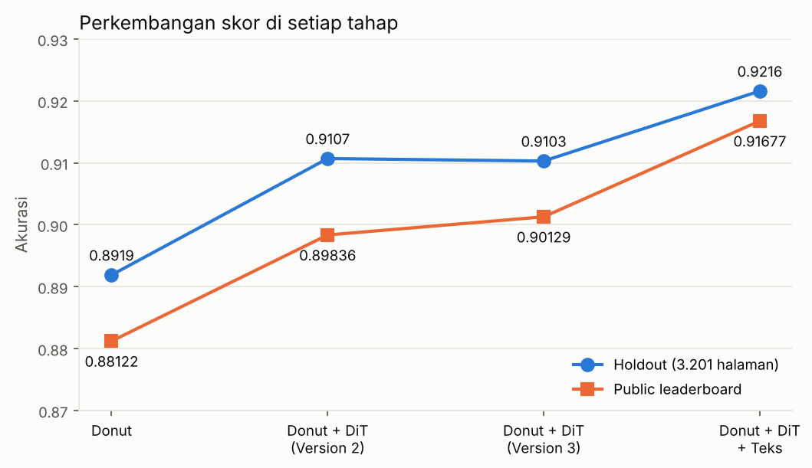
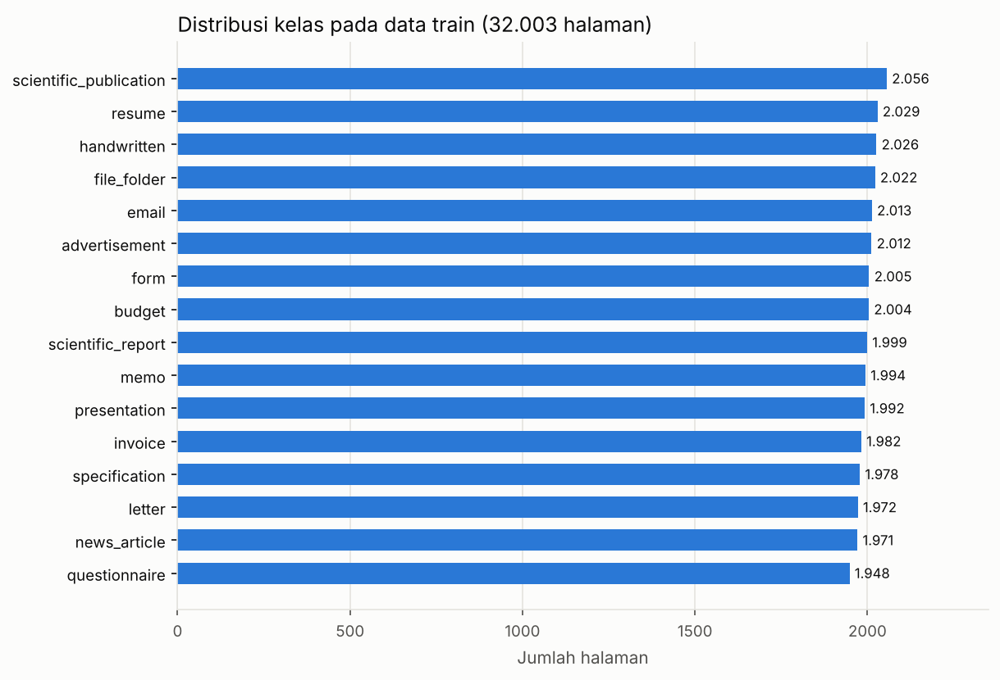
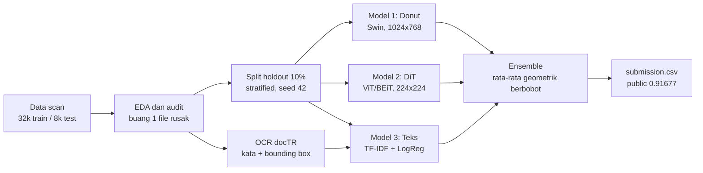
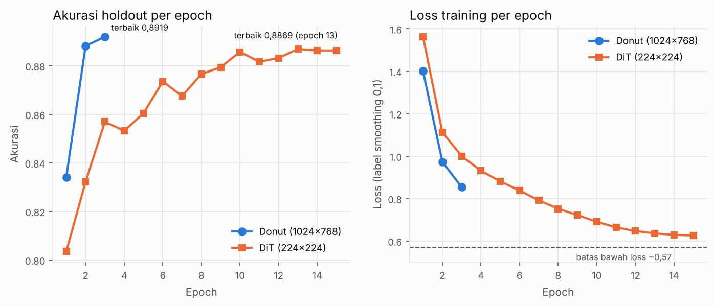
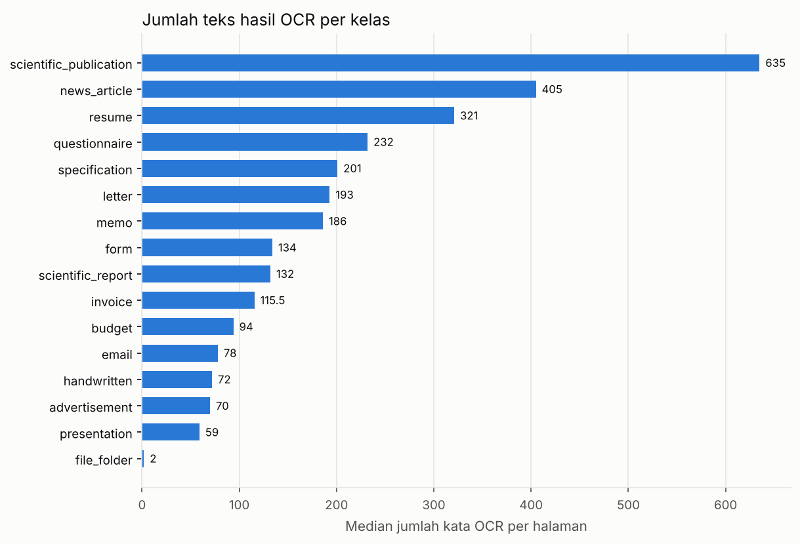
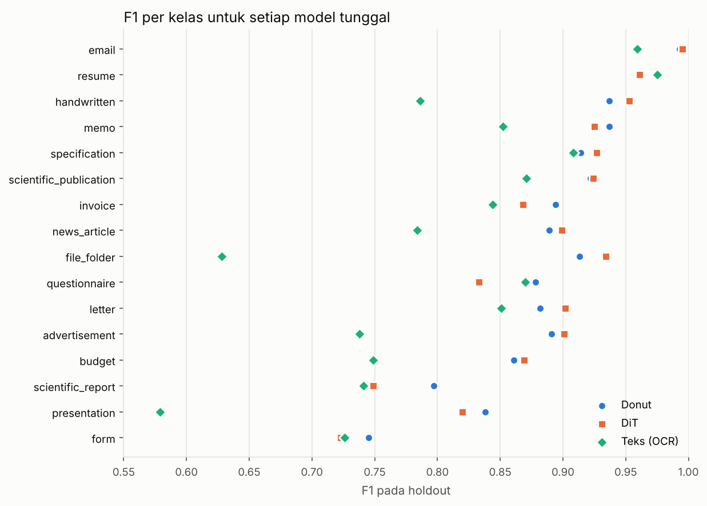
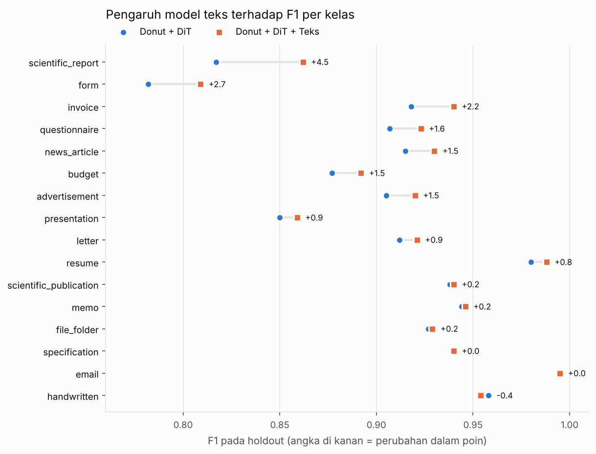

# Klasifikasi Dokumen Hasil Scan (RVL-CDIP) dengan Ensemble Donut, DiT, dan Model Teks OCR

**Tugas 2 — Supervised Machine Learning 2026**

| | |
|---|---|
| Nama | Yafi *(lengkapi nama lengkap)* |
| NRP | *5052241026* |
| Kompetisi | [Kaggle — Document Image Classification](https://www.kaggle.com/t/ec93bc56cc9842959bb6728723d23d29) |
| Framework | PyTorch + Hugging Face Transformers |

## Ringkasan Hasil

| Tahap | Akurasi holdout | Public score |
|---|---|---|
| Model 1: Donut encoder | 0.8919 | 0.88122 |
| Ensemble Donut + DiT | 0.9103 – 0.9107 | 0.89836 – 0.90129 |
| **Ensemble Donut + DiT + Teks (final)** | **0.9216** | **0.91677** |



Solusi akhir menggabungkan tiga model yang "melihat" dokumen dengan cara berbeda: dua model gambar berbasis Transformer (**Donut** pada 1024x768 dan **DiT** pada 224x224) serta satu **model teks** yang membaca kata-kata hasil OCR. Penggabungan ini menaikkan public score dari 0.88122 (satu model) menjadi **0.91677**.

---

## Daftar Isi

1. [Struktur Repository](#1-struktur-repository)
2. [Cara Penggunaan](#2-cara-penggunaan)
3. [Laporan dan Interpretasi](#3-laporan-dan-interpretasi)
4. [Referensi](#4-referensi)

---

## 1. Struktur Repository

```
.
├── README.md                    # cara penggunaan + laporan (file ini)
├── requirements.txt             # daftar library
├── .gitignore                   # data/, checkpoint/, dan file besar tidak di-commit
├── configs/                     # semua hyperparameter 
│   ├── donut.yaml
│   ├── dit.yaml
│   ├── ocr.yaml
│   └── text.yaml
├── notebooks/                   # workflow analisis, dijalankan berurutan
│   ├── 01_eda.ipynb             # eksplorasi data
│   ├── 02_donut_encoder.ipynb   # model 1 (hasil run asli Kaggle + output)
│   ├── 03_dit_ensemble.ipynb    # model 2 + ensemble 2 model (hasil run asli Kaggle)
│   ├── 04_ocr_doctr.ipynb       # ekstraksi teks OCR (hasil run asli Kaggle)
│   └── 05_text_ensemble.ipynb   # model teks + ensemble 3 model = submission final
├── src/                         # kode modular, semua function/class ber-docstring
│   ├── __init__.py
│   ├── config.py                # membaca configs/*.yaml
│   ├── utils.py                 # seed, device, pencarian file, analisis error
│   ├── data.py                  # metadata, audit gambar, split holdout, Dataset, DataLoader
│   ├── models.py                # DonutClassifier, DiTClassifier, grup parameter optimizer
│   ├── engine.py                # loop training, prediksi, checkpoint
│   ├── ocr.py                   # OCR docTR dan penyimpanan per shard
│   ├── text_model.py            # fitur TF-IDF + Logistic Regression
│   ├── ensemble.py              # penggabungan probabilitas + grid search bobot
│   ├── train_image.py           # CLI: training Donut / DiT
│   ├── run_ocr.py               # CLI: OCR seluruh halaman
│   ├── train_text.py            # CLI: training model teks
│   └── make_ensemble.py         # CLI: ensemble + menulis submission.csv
├── reports/
│   ├── make_figures.py          # membuat ulang grafik laporan
│   └── figures/                 # grafik yang dipakai di README
├── data/                        # (di-ignore) dataset kompetisi
└── checkpoint/                  # (di-ignore) bobot model, probabilitas, hasil OCR
```

**Hubungan `notebooks/` dan `src/`:** eksperimen sebenarnya saya jalankan di Kaggle, sehingga notebook 02–05 dibuat *self-contained* (semua kode ada di dalam notebook) dan disimpan **lengkap dengan output aslinya** sebagai bukti hasil. Logika yang sama kemudian saya rapikan menjadi modul di `src/` (dengan docstring) supaya bisa dijalankan ulang dari terminal tanpa notebook.

---

## 2. Cara Penggunaan

### 2.1 Persiapan environment

Python 3.10 atau lebih baru. GPU NVIDIA sangat disarankan untuk training model gambar dan OCR.

```bash
git clone https://github.com/yafifaldin/<nama-repo>.git
cd <nama-repo>
python -m venv .venv
source .venv/bin/activate          # Windows: .venv\Scripts\activate
pip install -r requirements.txt
```

### 2.2 Mengunduh data

Dataset (~4,9 GB) **tidak** disimpan di repository. Cara mengunduhnya:

1. Buka [link kompetisi](https://www.kaggle.com/t/ec93bc56cc9842959bb6728723d23d29), login, lalu klik **Join Competition** dan setujui aturannya.
2. Buat API token di Kaggle: **Settings → API → Create New Token**. File `kaggle.json` akan terunduh. Simpan di `~/.kaggle/kaggle.json` (Windows: `C:\Users\<user>\.kaggle\kaggle.json`). File ini sudah masuk `.gitignore`; jangan di-commit.
3. Unduh dan ekstrak data ke folder `data/`:

```bash
kaggle competitions download -c document-image-classification-sd234504 -p data/
cd data && unzip -q document-image-classification-sd234504.zip && cd ..
```

Kode mencari `train.csv` secara otomatis di bawah `data/`, jadi nama subfolder hasil ekstrak tidak harus sama persis. Struktur yang diharapkan:

```
data/
├── train/train/<kelas>/*.tif    # 32.003 gambar, 16 subfolder
├── test/test/test_*.tif         # 7.994 gambar
├── train.csv
├── test.csv
└── sample_submission.csv
```

### 2.3 Menjalankan pipeline dari terminal (`src/`)

Jalankan dari root repository, berurutan:

```bash
python -m src.train_image --model donut   # Model 1 -> checkpoint/donut/  (+ checkpoint/holdout_ids.csv)
python -m src.train_image --model dit     # Model 2 -> checkpoint/dit/    (memakai holdout yang sama)
python -m src.run_ocr                     # OCR     -> checkpoint/ocr/    (bisa dilanjutkan jika terhenti)
python -m src.train_text                  # Teks    -> checkpoint/text/
python -m src.make_ensemble --models donut dit text   # -> submission.csv
```

Semua hyperparameter bisa diubah di `configs/*.yaml`. Perkiraan waktu dengan GPU T4: Donut ~7,5 jam, DiT ~1 jam, OCR ~5,6 jam, model teks + ensemble ~1 jam (CPU).

### 2.4 Menjalankan di Kaggle (cara yang saya pakai)

| Notebook | Accelerator | Input yang dilampirkan (Add Input) |
|---|---|---|
| `01_eda` | None (CPU) | data kompetisi (+ opsional output `04`) |
| `02_donut_encoder` | GPU T4, Internet ON | data kompetisi |
| `03_dit_ensemble` | GPU T4, Internet ON | data kompetisi + output `02` |
| `04_ocr_doctr` | GPU T4, Internet ON | data kompetisi |
| `05_text_ensemble` | None (CPU) | data kompetisi + output `02`, `03`, `04` |

Setiap notebook punya variabel `QUICK_RUN`. Set `True` untuk uji cepat pada subset kecil, lalu `False` dan jalankan lewat **Save Version → Save & Run All (Commit)** agar proses tetap berjalan walaupun browser ditutup. File submission diambil dari tab **Output** notebook `05`.

> Catatan: tombol *Submit to Competition* di editor Kaggle akan **menjalankan ulang** seluruh notebook (memakai kuota GPU lagi). Untuk men-submit output yang sudah ada, gunakan tab Output pada halaman versi notebook.

### 2.5 Membuat ulang grafik laporan

```bash
python reports/make_figures.py
```

---

## 3. Laporan dan Interpretasi

### 3.1 Latar belakang dan tujuan

Tugas ini adalah klasifikasi **gambar dokumen hasil scan** ke dalam 16 kategori bisnis (advertisement, budget, email, form, invoice, letter, memo, dan lain-lain). Data berasal dari benchmark RVL-CDIP, yaitu scan arsip dokumen industri tembakau tahun 1980–1990-an. Tujuan saya adalah memaksimalkan akurasi pada data test dengan model berbasis neural network di PyTorch.

### 3.2 Dataset dan hasil EDA

| Aspek | Temuan |
|---|---|
| Jumlah data | 32.003 train, 7.994 test, 16 kelas |
| Distribusi kelas | Seimbang, 1.948 – 2.056 halaman per kelas |
| Ukuran gambar | Median 759 x 1000 px, grayscale/1-bit (~100 dpi) |
| File rusak | 1 file train (kelas scientific_publication) tidak bisa dibuka |
| Halaman kosong total | 0 |



**Kondisi kualitas data.** Saat melihat sampel gambar, saya menemukan banyak masalah kualitas: border hitam tebal dari mesin scan, halaman sebelumnya yang ikut terbawa di bagian atas, cetakan yang sangat samar, tulisan tangan yang diputar 90°, nomor arsip (Bates number) vertikal di setiap halaman, dan halaman yang hampir kosong (misalnya sampul map).

**Interpretasi EDA dan keputusan yang diambil:**

1. **Kelas seimbang**, sehingga akurasi adalah metrik yang adil dan tidak perlu class weighting.
2. **Gambar tidak dibersihkan.** Kondisi scan yang buruk ini *sama* di data train dan test. Jika saya melakukan denoising atau crop border, ada risiko menghapus informasi yang justru menjadi ciri kelas (misalnya ruang kosong pada `file_folder`). Model lebih baik belajar langsung dari kondisi yang sama dengan data test.
3. **Downsampling harus antialiased.** Banyak gambar 1-bit dengan goresan tipis. Resize *nearest neighbor* bisa menghilangkan teks, jadi saya memakai filter BOX/BILINEAR yang mempertahankan goresan tipis sebagai piksel abu-abu.
4. **Resolusi di atas ~1000 px tidak berguna**, karena gambar aslinya hanya setinggi 1000 px. Resolusi 1024x768 untuk Donut sudah hampir sama dengan resolusi asli.
5. **Hanya file yang rusak yang dibuang** (1 file). Halaman yang sulit tetapi valid tetap dipakai, karena halaman seperti itu juga ada di data test.

### 3.3 Workflow analisis



Prinsip yang saya pegang di setiap tahap:

- **Satu holdout untuk semua model.** Split 90/10 dibuat sekali (stratified, seed 42) dan id-nya disimpan. Semua model dievaluasi pada 3.201 gambar yang **persis sama**, sehingga probabilitasnya bisa digabung dan bobot ensemble bisa diatur dengan adil.
- **Uji cepat dulu, baru run penuh.** Setiap notebook punya mode `QUICK_RUN` untuk memastikan path, memori GPU, dan seluruh loop berjalan sebelum menghabiskan berjam-jam kuota GPU.
- **Keputusan berdasarkan angka holdout.** Setiap ide baru (model baru, cara gabung, relabeling) hanya dipakai jika menaikkan akurasi holdout.

### 3.4 Keputusan desain penting

**a. Tidak memakai checkpoint yang sudah di-finetune pada RVL-CDIP.** Di Hugging Face tersedia `donut-base-finetuned-rvlcdip` dan `dit-base-finetuned-rvlcdip`. Model-model itu sudah dilatih pada RVL-CDIP penuh, yang kemungkinan besar memuat gambar test kompetisi ini. Memakainya berarti *data leakage*: skor akan naik tetapi tidak jujur. Saya hanya memakai checkpoint *pretrained* umum (`donut-base`, `dit-base`) lalu melakukan fine-tuning sendiri.

**b. Hipotesis label noise dan relabeling dengan VLM.** RVL-CDIP diketahui memiliki label noise. Saya sempat mempertimbangkan memakai Vision-Language Model untuk me-relabel data train. Sebelum melakukannya, saya menguji dulu apakah label test lebih "bersih" daripada label train, dengan membandingkan akurasi holdout (label train) dan public score (label test):

| | Holdout | Public | Selisih |
|---|---|---|---|
| Donut | 0.8919 | 0.8812 | -1.1 poin |

Selisihnya kecil dan public justru sedikit lebih rendah. Artinya label test **mengikuti konvensi dan noise yang sama** dengan label train, bukan lebih bersih. Pola kesalahan model juga hanya terjadi antar kelas yang memang mirip (form ↔ invoice, scientific_report ↔ presentation), bukan pasangan aneh yang menandakan noise buatan. Kesimpulannya, relabeling dengan VLM justru berisiko **menjauhkan** label train dari label test, sehingga ide ini tidak saya lanjutkan.

**c. Variasi antar run.** Notebook 03 sempat terjalankan ulang (Version 3) dengan kode dan seed yang sama. Hasilnya sedikit berbeda (public 0.89836 vs 0.90129), karena training di GPU tidak 100% deterministik. Dari sini saya mengambil patokan: **perbedaan di bawah ~0.3 poin dianggap noise**, dan model baru baru dianggap berguna jika gain-nya jelas melebihi batas itu.

### 3.5 Model 1 — Donut Encoder (Swin Transformer)

**Arsitektur.** Donut adalah model pemahaman dokumen "OCR-free" dari NAVER CLOVA yang dipretrain untuk membaca jutaan halaman dokumen. Saya hanya memakai **encoder Swin Transformer**-nya (decoder teks dibuang), lalu menambahkan *mean pooling* + LayerNorm + Dropout + Linear (16 kelas). Total 74,2 juta parameter.

**Alasan memilih Donut:** encoder-nya sudah terbiasa dengan dokumen dan bisa dipakai pada resolusi tinggi (1024x768) sehingga detail teks yang kecil masih terlihat oleh model.

| Hyperparameter | Nilai |
|---|---|
| Resolusi input | 1024 x 768 |
| Batch efektif | 16 (8 x gradient accumulation 2) |
| Optimizer | AdamW, LR encoder 3e-5, LR head 1e-3, weight decay 0.05 |
| Scheduler | Cosine dengan warmup 5% |
| Regularisasi | Label smoothing 0.1, augmentasi ringan (rotasi ±2°, geser 2%, kontras, blur) |
| Efisiensi | Mixed precision fp16, gradient checkpointing |
| Epoch | 3 (masing-masing 145 menit di T4) |

**Hasil:** akurasi holdout **0.8919** (macro-F1 0.8915), public **0.88122**.

### 3.6 Model 2 — DiT-base (Document Image Transformer)

**Arsitektur.** DiT dari Microsoft adalah Vision Transformer (arsitektur BEiT) yang dipretrain secara *self-supervised* pada 42 juta halaman dokumen IIT-CDIP, yaitu sumber yang sama dengan RVL-CDIP. Head klasifikasi baru (16 kelas) ditambahkan di atasnya. Total 85,8 juta parameter.

**Alasan memilih DiT:** untuk ensemble, model kedua harus **berbeda** dari model pertama agar kesalahannya tidak sama. DiT berbeda arsitektur (ViT vs Swin), resolusi (224 vs 1024), dan data pretraining dengan Donut. DiT juga jauh lebih murah (~65 menit vs ~7,5 jam).

| Hyperparameter | Nilai |
|---|---|
| Resolusi input | 224 x 224 (semua gambar di-cache di RAM, ~2 GB) |
| Batch | 64 |
| Optimizer | AdamW, LR 2e-4 dengan **layer-wise LR decay 0.75**, weight decay 0.05 |
| Scheduler | Cosine dengan warmup 1 epoch |
| Regularisasi | Label smoothing 0.1, drop path 0.1, augmentasi ringan |
| Epoch | 15 (4,3 menit/epoch) |

*Layer-wise LR decay* membuat layer bawah (fitur umum hasil pretraining) hanya berubah sedikit, sedangkan layer atas dan head beradaptasi lebih cepat. Ini resep fine-tuning standar untuk model keluarga BEiT/DiT.

**Hasil:** akurasi holdout **0.8869** (epoch terbaik ke-13), hampir menyamai Donut dengan biaya komputasi ~7x lebih kecil.



**Interpretasi kurva training:**

- **Donut** naik tajam dari 0.834 ke 0.888 di epoch 2, lalu hanya +0.4 poin di epoch 3. Dengan biaya 145 menit per epoch, menambah epoch keempat tidak sepadan.
- **DiT** terus naik sampai epoch 13 lalu mendatar. Pendataran di akhir sebagian disebabkan scheduler cosine yang menurunkan LR mendekati nol. Loss training akhir (0.626) sudah dekat dengan batas bawah teoretis (~0.57 karena label smoothing 0.1 pada 16 kelas), jadi menambah epoch kemungkinan besar tidak akan banyak membantu.
- Loss training kedua model masih di atas batas bawah dan akurasi holdout tidak turun, sehingga **tidak terlihat overfitting yang berarti**.

### 3.7 Ensemble 2 model (Donut + DiT)

Probabilitas kedua model digabung dengan `P = w·Donut + (1-w)·DiT`. Bobot `w` dicari dari 0 sampai 1 (langkah 0.05) pada holdout.

| | Holdout |
|---|---|
| Donut saja | 0.8919 |
| DiT saja | 0.8869 |
| **Ensemble (w_Donut = 0.65)** | **0.9107** |

Gain sebesar **+1.9 poin** muncul karena kedua model hanya setuju pada 88.6% halaman test; kesalahan keduanya cukup berbeda. Public score naik ke **0.89836** (Version 3: 0.90129).

### 3.8 Analisis error kedua model gambar

Kelas yang paling lemah pada kedua model adalah **form** (F1 0.72–0.75), **scientific_report** (0.75–0.80), dan **presentation** (0.82–0.84). Pasangan yang paling sering tertukar:

| Benar → Prediksi (Donut) | Jumlah |
|---|---|
| form → invoice | 11 |
| scientific_report → presentation | 10 |
| scientific_report → form | 10 |
| presentation → scientific_report | 10 |
| form → scientific_report / budget | 9 / 9 |

**Interpretasi:** semua pasangan ini adalah dokumen yang **tampilannya mirip** (kotak-kotak, garis, angka, paragraf). Yang membedakannya adalah **isi kata-katanya**: invoice bertuliskan "Invoice No.", "Amount due"; laporan ilmiah bertuliskan "PROJECT TITLE", "PERIOD COVERED". Model gambar pada 224 px tidak bisa membaca teks, dan Donut pada 1024 px hanya "melihat" teks secara implisit. Ini menjadi motivasi untuk menambahkan **informasi teks secara eksplisit** melalui OCR.

### 3.9 Ekstraksi teks dengan OCR docTR

Saya memakai **docTR**, OCR berbasis PyTorch yang terdiri dari dua neural network: detektor teks (`db_resnet50`) dan pengenal teks (`crnn_vgg16_bn`). Selain kata, posisi setiap kata (bounding box) juga disimpan. Seluruh **39.997 halaman** (train + test) berhasil di-OCR dalam 5,6 jam di GPU T4.



| Kelas | Median kata | Halaman < 5 kata | Confidence |
|---|---|---|---|
| form | 134 | 3.3% | 0.85 |
| scientific_report | 132 | 3.1% | 0.88 |
| invoice | 115.5 | 4.6% | 0.81 |
| questionnaire | 232 | 2.4% | 0.88 |
| presentation | 59 | 24.8% | 0.76 |
| handwritten | 72 | 4.7% | 0.63 |
| file_folder | 2 | 67.8% | 0.55 |

**Interpretasi kualitas OCR:**

- **Temuan terpenting:** kelas yang paling sulit bagi model gambar (form, scientific_report, invoice, questionnaire) justru memiliki **teks yang banyak dan terbaca** (confidence 0.81–0.88). Contohnya, OCR pada sebuah scientific_report menghasilkan "PROJECT TITLE : CONTRACT RESEARCH PERIOD COVERED : NOVEMBER 1979", tepat kata kunci yang dibutuhkan.
- **file_folder** hampir tidak punya teks (68% halaman < 5 kata). Ini bukan kegagalan OCR; sampul map memang hampir kosong. Jumlah kata yang sangat sedikit itu sendiri sudah menjadi sinyal.
- **handwritten** memiliki confidence rendah (0.63) karena docTR dilatih untuk teks cetak, bukan tulisan tangan.
- **presentation** sering berupa slide penuh grafik (25% hampir tanpa teks), sehingga bantuan teks untuk kelas ini terbatas.

### 3.10 Model 3 — Model teks (TF-IDF + Logistic Regression)

**Fitur:**

- Teks dinormalisasi: huruf kecil, setiap digit diganti `0` (nomor Bates, tanggal, dan nominal menjadi beberapa pola bersama saja).
- **TF-IDF kata 1–2-gram** (200 ribu fitur) untuk menangkap kata kunci seperti "invoice" dan "period covered".
- **TF-IDF karakter 3–5-gram** (300 ribu fitur) agar tahan terhadap salah eja OCR. Contohnya, "LABORNTORY" masih berbagi potongan "LABOR" dan "TORY" dengan "LABORATORY".
- `min_df=3` membuang token yang muncul di kurang dari 3 halaman, sehingga sebagian besar "sampah" OCR (noda, stempel) hilang.
- Dua fitur halaman: jumlah kata dan rata-rata confidence OCR.

**Model:** Logistic Regression multinomial (scikit-learn). Secara matematis model ini setara dengan neural network satu layer (linear + softmax) yang dilatih dengan cross-entropy. Nilai C dipilih pada holdout:

| C | 1 | **4** | 16 |
|---|---|---|---|
| Akurasi holdout | 0.7929 | **0.8010** | 0.7988 |

Untuk prediksi test, model dilatih ulang pada seluruh 32.003 data train dengan C = 4.

**Gating halaman kosong:** pada halaman dengan < 5 kata OCR, probabilitas model teks diganti menjadi uniform (1/16 untuk semua kelas). Probabilitas uniform menambah nilai yang sama ke setiap kelas, sehingga model teks tidak ikut menentukan; keputusan diserahkan ke model gambar.

### 3.11 Ensemble 3 model (submission final)

Ketiga model digabung dengan **rata-rata geometrik berbobot** (rata-rata log-probabilitas). Bobot dicari dengan grid search langkah 0.05 pada holdout, untuk dua cara gabung (rata-rata biasa dan geometrik).

| | Holdout | Public |
|---|---|---|
| Teks saja | 0.8010 | – |
| Ensemble 2 model (geo, Donut 0.6 / DiT 0.4) | 0.9103 | 0.90129 |
| **Ensemble 3 model (geo, Donut 0.40 / DiT 0.25 / Teks 0.35)** | **0.9216** | **0.91677** |

**Hasil ini stabil:** 10 kombinasi bobot terbaik semuanya berada di 0.919–0.922, jadi bukan puncak kebetulan di satu titik grid. Rata-rata geometrik menempati seluruh 10 posisi teratas.





| Kelas | Teks saja | 2 model | 3 model | Perubahan |
|---|---|---|---|---|
| scientific_report | 0.741 | 0.817 | 0.862 | **+4.5** |
| form | 0.726 | 0.782 | 0.809 | **+2.7** |
| invoice | 0.844 | 0.918 | 0.940 | **+2.2** |
| questionnaire | 0.870 | 0.907 | 0.923 | +1.6 |
| advertisement | 0.738 | 0.905 | 0.920 | +1.5 |
| news_article | 0.784 | 0.915 | 0.930 | +1.5 |
| budget | 0.749 | 0.877 | 0.892 | +1.5 |
| presentation | 0.579 | 0.850 | 0.859 | +0.9 |
| handwritten | 0.786 | 0.958 | 0.954 | -0.4 |

*(Kolom 2 dan 3 model memakai output DiT Version 3; grafik "F1 per kelas tiap model" memakai DiT Version 2.)*

### 3.12 Interpretasi: mengapa model teks yang lemah bisa menaikkan skor?

Model teks sendirian hanya mencapai **0.801**, lebih rendah dari kedua model gambar. Namun menambahkannya ke ensemble menaikkan akurasi **+1.1 poin** di holdout dan **+1.5 poin** di public. Menurut analisis saya, ada tiga penyebab:

1. **Keragaman kesalahan (error diversity).** Donut dan DiT sama-sama melihat *piksel*, sehingga keduanya gagal pada hal yang sama: halaman yang tampilannya mirip. Model teks melihat *kata*, sehingga gagal pada halaman yang berbeda (map kosong, tulisan tangan, slide bergambar). Ensemble bekerja paling baik ketika kesalahan antar model tidak tumpang tindih. Grafik "F1 per kelas tiap model" memperlihatkan pola ini: model teks menyamai Donut pada resume (0.975) dan mengalahkan DiT pada questionnaire (0.870 vs 0.833) dan form (0.726 vs 0.723), tetapi sangat lemah pada file_folder (0.628) dan presentation (0.579), justru kelas yang mudah bagi model gambar.
2. **Rata-rata geometrik memberi "hak veto" pada model yang yakin.** Pada halaman yang kaya kata kunci, model teks sangat yakin ("invoice" 0.95), sementara model gambar ragu antara form dan invoice (0.5 / 0.4). Penjumlahan log-probabilitas membuat suara yang yakin menentukan hasil. Pada halaman tanpa teks, gating membuat model teks netral sehingga model gambar yang memutuskan.
3. **Data training lebih banyak untuk model teks.** Model teks untuk prediksi test dilatih ulang pada 100% data train (termasuk holdout), sedangkan angka holdout berasal dari model yang dilatih pada 90% data. Ini kemungkinan menjelaskan mengapa gain di public (+1.5) sedikit lebih besar daripada di holdout (+1.1).

Bukti paling kuat ada di tabel per kelas: kenaikan terbesar tepat terjadi pada kelas yang **kaya teks tetapi tampilannya membingungkan** (scientific_report, form, invoice, questionnaire). Kelas yang sudah mudah secara visual (email, specification) tidak berubah, dan handwritten sedikit turun karena OCR memang tidak bisa membaca tulisan tangan.

### 3.13 Analisis error yang tersisa

| Benar → Prediksi (ensemble 3 model) | Jumlah |
|---|---|
| scientific_report → presentation | 11 |
| scientific_report → form | 10 |
| form → invoice | 8 |
| scientific_report → budget | 7 |
| form → budget | 7 |
| specification → form / news_article → presentation / memo → letter | 6 / 6 / 6 |

Jumlah kesalahan form → invoice turun dari 11 (Donut) dan 18 (DiT) menjadi 8. Kesalahan yang tersisa masih berpusat pada scientific_report dan form. Kedua kelas ini sangat beragam isinya, dan sebagian batasnya memang ambigu bahkan bagi manusia (bagian dari label noise RVL-CDIP). **Posisi kata** di halaman (misalnya blok header di atas, atau kata-kata pendek tersusun dalam grid kotak) belum dimanfaatkan oleh model teks berbasis TF-IDF, padahal informasi itu kemungkinan bisa membantu memisahkan kelas-kelas ini.

### 3.14 Riwayat submission

| # | Submission | Public score | Keterangan |
|---|---|---|---|
| 1 | Donut Encoder (Version 2) | 0.88122 | Baseline satu model |
| 2 | Donut + DiT (`submission.csv` manual) | 0.89836 | Ensemble 2 model, DiT Version 2 |
| 3 | Donut + DiT (notebook Version 3) | 0.90129 | Run ulang otomatis oleh tombol Submit |
| 4 | **Donut + DiT + Teks** | **0.91677** | **Submission final** |

Selisih holdout dan public konsisten sekitar 0.5–1.2 poin di setiap tahap, dan setiap kenaikan di holdout selalu diikuti kenaikan di public. Ini menunjukkan holdout yang saya pakai adalah pengganti leaderboard yang andal, sehingga keputusan bisa diambil tanpa menghabiskan jatah submission harian.

### 3.15 Keterbatasan dan pengembangan selanjutnya

- **LayoutLMv3 belum dijalankan.** Saya sudah menyiapkan dan menguji pipeline LayoutLMv3 (model yang membaca teks, *posisi* kata, dan gambar sekaligus), karena posisi kata adalah informasi yang belum dipakai oleh model teks saya. Model ini tidak sempat dijalankan karena kuota GPU mingguan Kaggle habis.
- **Model gambar belum dilatih ulang pada 100% data train.** Saat ini Donut dan DiT dilatih pada 90% data (10% untuk holdout). Melatih ulang pada seluruh data biasanya menambah beberapa persepuluh poin.
- **Stacking.** Bobot ensemble saat ini sama untuk semua kelas. Meta-model yang mempelajari bobot per kelas (misalnya lebih percaya model teks untuk invoice dan model gambar untuk handwritten) berpotensi lebih baik.
- **OCR tulisan tangan.** docTR lemah pada tulisan tangan; OCR khusus tulisan tangan bisa membantu kelas handwritten dan letter.
- **Holdout sedikit optimistis.** Epoch terbaik dan bobot ensemble sama-sama dipilih pada holdout yang sama. Private score adalah ukuran akhir yang sebenarnya.
- **Model teks memakai scikit-learn.** Logistic Regression secara matematis adalah neural network satu layer, tetapi dilatih dengan scikit-learn, bukan PyTorch. Versi PyTorch (misalnya MLP di atas fitur TF-IDF) bisa menjadi pengganti langsung.

### 3.16 Kesimpulan

1. Untuk klasifikasi dokumen hasil scan, **model yang dipretrain pada dokumen** (Donut, DiT) memberikan baseline yang kuat (0.887–0.892 holdout) hanya dengan fine-tuning beberapa epoch.
2. **Menggabungkan model dengan "sudut pandang" berbeda** lebih efektif daripada memperbesar satu model. Dua model gambar yang berbeda arsitektur dan resolusi menambah +1.9 poin, dan model teks yang lemah sendirian (0.80) masih menambah +1.1 poin karena kesalahannya berbeda.
3. Kesalahan model gambar terpusat pada kelas yang tampilannya mirip tetapi isinya berbeda. Informasi teks dari OCR memperbaiki tepat kelas-kelas tersebut (scientific_report +4.5, form +2.7, invoice +2.2 poin F1).
4. Keputusan berbasis bukti (menguji hipotesis label noise, mengukur variasi antar run, memakai satu holdout yang konsisten) mencegah langkah yang berisiko, seperti relabeling dengan VLM, dan menjaga setiap peningkatan tetap terukur.

Hasil akhir: **akurasi holdout 0.9216, public score 0.91677.**

---

## 4. Referensi

1. Harley, A. W., Ufkes, A., & Derpanis, K. G. (2015). *Evaluation of Deep Convolutional Nets for Document Image Classification and Retrieval.* ICDAR. (Dataset RVL-CDIP)
2. Kim, G., et al. (2022). *OCR-free Document Understanding Transformer (Donut).* ECCV.
3. Li, J., et al. (2022). *DiT: Self-supervised Pre-training for Document Image Transformer.* ACM Multimedia.
4. Bao, H., Dong, L., Piao, S., & Wei, F. (2022). *BEiT: BERT Pre-Training of Image Transformers.* ICLR.
5. Liu, Z., et al. (2021). *Swin Transformer: Hierarchical Vision Transformer using Shifted Windows.* ICCV.
6. Mindee. (2021). *docTR: Document Text Recognition.* https://github.com/mindee/doctr
7. Huang, Y., et al. (2022). *LayoutLMv3: Pre-training for Document AI with Unified Text and Image Masking.* ACM Multimedia.
